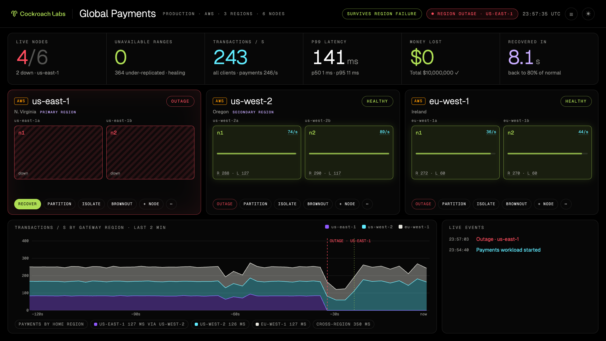
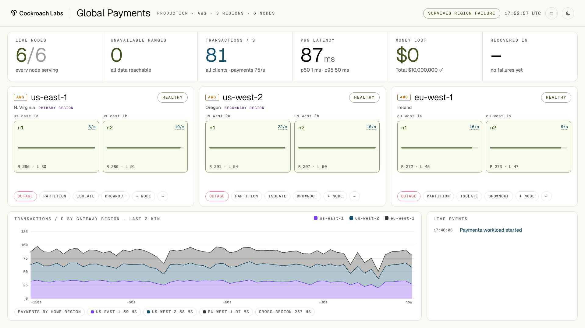
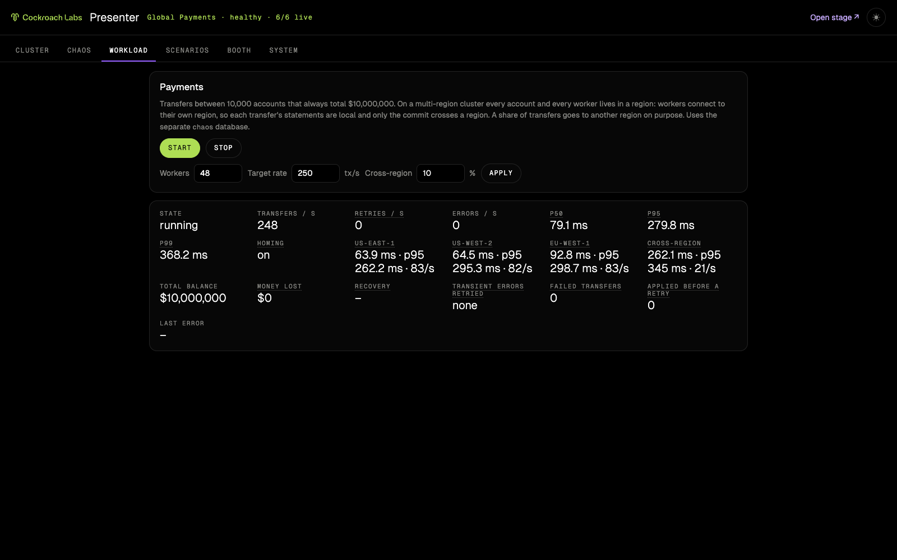
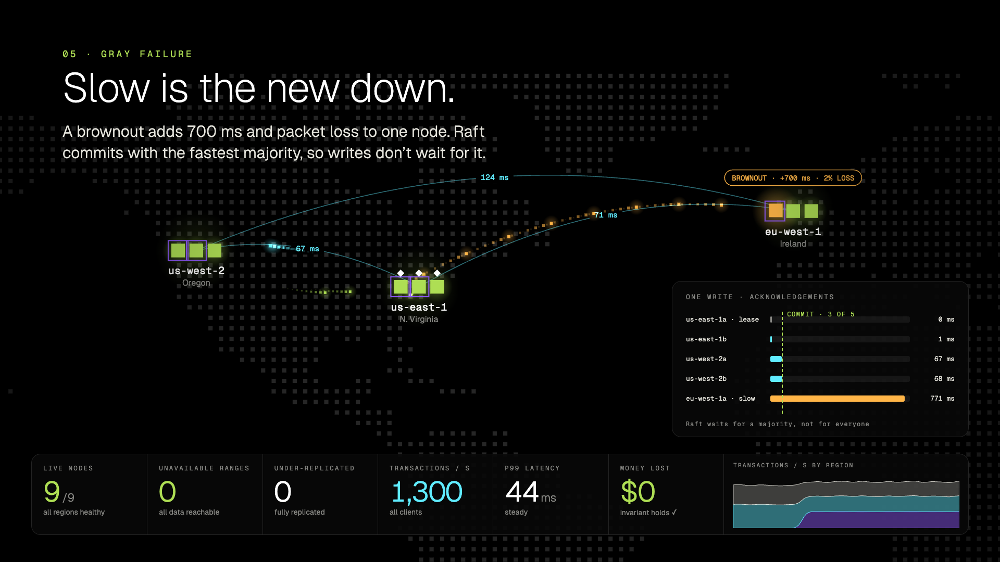

# CockroachDB Multi-Region Chaos Demo

A live, cloud-looking CockroachDB cluster on your laptop. A control plane builds the cluster from a
**preset** with whatever region names you need (AWS, Google Cloud, Azure, IBM, OCI, multi-cloud or your own),
puts a global load balancer in front of it, and gives you:

- a **stage** for big screens and booths: live regions and nodes, traffic by region, recovery time, money lost
- a **presenter console** (laptop, phone, or a drawer on the stage) for every control
- **chaos**: crash, planned stop, partition, brownout and isolate nodes, zones or whole regions, with
  realistic latency between regions
- **elasticity**: add or decommission nodes, add or remove regions, switch survival goals, all live
- a built-in **Payments** workload with a $10,000,000 invariant, plus Banko AI Assistant support
- eleven guided **scenarios**, a **booth mode** with hardware triggers, and a **motion explainer**



*The stage during a primary-region outage under load: us-east-1 is down, every range is still available, no money
is lost, and payments are back to normal in 8.1 s at the full 250 transfers/s, with us-east-1's customers served
from us-west-2 until it heals.*

Everything runs locally; the stage never shows that. Nothing is sent anywhere.

## Quick start

    ./run.sh up                 # default preset: aws (3 regions × 2 nodes)
    ./run.sh up --preset gcp    # rebuild with Google Cloud regions
    ./run.sh status
    ./run.sh down

| What | URL |
|---|---|
| Stage (put this on the big screen) | http://localhost:8088 |
| Presenter console | http://localhost:8088/presenter |
| Explainer | http://localhost:8088/explainer/chaos, `/explainer/playlist` |
| SQL (Banko, psql, any Postgres client) | `postgresql://root@localhost:26257/defaultdb?sslmode=disable` |
| DB Console (stays up when nodes die) | http://localhost:8080 |
| Load balancer stats | http://localhost:8404/stats |

Needs Docker Desktop or Podman with compose, about 8 GB of memory for the default 6 nodes given to the
Docker/Podman VM (each node settles around 1 GiB; add nodes from the stage when there's room, and the `small`
preset runs in 8 GB laptops), and ports 26257, 8080, 8088 and 8404.
`./run.sh up` checks all of that first.

## The stage

Region columns with every node as a tile (replicas, leases, traffic), a KPI strip, a live traffic chart by
gateway region with failure and recovery markers, an event ticker, and the scenario card. It is designed at
1920×1080 and scales to any screen. Click a node for its menu; region buttons sit under each region.



| Key | Does |
|---|---|
| `1`–`9` | fire the mapped trigger (booth hardware, see below) |
| `P` | presenter drawer (close with ✕, `Esc` or `P`) |
| `N` or `→` | next scenario step |
| `T` | dark / light theme (also `?theme=light`) |
| `F` | fullscreen |
| `E` | explainer playlist; any key returns |
| `C` | preview the recovery celebration (it plays by itself when every node is back; `?confetti=0` turns the confetti off) |

If `CONTROL_TOKEN` is set, the stage is read-only until you open `/presenter?token=…` once in that browser.

## Presenter console

Tabs: **Cluster** (presets, custom preset editor, latency, survival goal, primary region, add node/region),
**Chaos** (any target, any action, brownout settings, decommission, remove region), **Workload**,
**Scenarios**, **Booth** (auto-heal, counters, trigger map) and **System** (the real endpoints and logs).
It works on a phone, so you can drive the demo from your pocket.



## Deployment models

**Multi-region** (default) spreads the preset's regions across the map: it survives losing a whole region, can span
clouds, and shows locality features like REGIONAL BY ROW and follower reads.

**Single region** is for customers who run in one region: the preset's primary region on its own, with one node per
availability zone (3 to start, add more with **+ Node**). It survives losing a node or a whole zone, and scales the
same way. The stage shows a zone-outage button per zone, and the **Survive a zone outage** scenario is its headline.

    ./run.sh up --model single-region                  # aws: us-east-1 across 3 zones
    ./run.sh up --preset azure --model single-region   # eastus across 3 zones

Set `DEPLOYMENT_MODEL` in `.env` to change the default, or switch from the presenter (Cluster → Presets → Deployment
model, then rebuild). Adding a region to a single-region cluster turns it multi-region.

## Presets and your own regions

| Preset | Regions (nodes) | Survival goal |
|---|---|---|
| `aws` | us-east-1 (2), us-west-2 (2), eu-west-1 (2) | region |
| `gcp` | us-east1 (2), us-central1 (2), europe-west1 (2) | region |
| `azure` | eastus (2), westus2 (2), westeurope (2) | region |
| `ibm` | us-south (2), us-east (2), eu-de (2) | region |
| `multi-cloud` | aws us-east-1 (2), gcp us-central1 (2), azure westus2 (2) | region |
| `classic` | us-east-1 (2), us-west-2 (2), us-east-2 (1) | region |
| `small` | us-east-1, us-west-2, eu-west-1 (1 each), for 8 GB laptops | none (plain 3× replication) |

Make your own in the presenter console (Cluster → Custom preset), or copy a file in `presets/` to
`presets/custom/<name>.yaml`:

```yaml
display_name: Acme Bank        # shown on the stage and in the explainer: use your customer's name
cluster_id: acme-bank
survival_goal: auto            # auto | zone | region | none
latency: realistic             # realistic | off | a multiplier such as 0.5
regions:
  - { name: eastus, provider: azure, nodes: 3, primary: true }
  - { name: westus2, provider: azure, nodes: 3, secondary: true }
  - { name: mars-north-1, provider: custom, nodes: 3, label: Olympus Mons, location: [18.6, -133.8] }
```

Real zone names, cities and map coordinates come from `catalog/regions.yaml`; unknown regions work too.
Latency between regions follows their distance. Up to 15 nodes by default (`MAX_NODES`).

## Chaos and elasticity

| Target | Actions |
|---|---|
| Node | crash, planned stop, partition, brownout (+700 ms ±200, 2% loss by default), recover, decommission |
| Zone | zone outage |
| Region | outage, partition, isolate (cut off from other regions while clients still connect), brownout, recover, remove |
| Cluster | recover everything, add a node or region, survival goal, primary region, latency |

Before an action that would exceed the survival goal (for example a second region outage under REGION
survival), the panel shows what would become unavailable and asks you to confirm.

## Payments workload

Transfers between 10,000 accounts (UUID keys) holding $10,000,000 in total, in the separate `chaos` database
so it never touches Banko's data. 48 workers at 250 transfers/s by default.

On a multi-region cluster every account and every worker lives in a region. `accounts` and `transfers` are
`REGIONAL BY ROW` with the region in the primary key, the accounts are spread evenly over the regions, and each
worker connects straight to a node in its own region: every statement of a transfer is local and only the commit
crosses a region, the way a real regional deployment works. One transfer in ten (the cross-region share, adjustable
in the presenter) pays an account in another region on purpose and costs one more round trip. When a region goes
down, its workers reconnect to the nearest live region, keep paying their own accounts, and come home when it heals.
The stage shows p50 latency per home region under the traffic chart. With realistic latency on the aws preset, a
single write from the home gateway measured 63 ms in us-east-1 and us-west-2 and 97 ms in eu-west-1, against 180 to
240 ms for the same write from another region's gateway, which is what the old layout paid on two thirds of its
transfers. A cluster whose `chaos` database is not multi-region (survival goal none, as on the `small` preset)
keeps plain tables through the load balancer.

Retries follow CockroachDB best practice (`controlplane/controlplane/retry.py`, matching cockroachdb-jdbc-wrapper,
langchain-cockroachdb and Banko): `40001` serialization failures, `40003` ambiguous results, `08xxx` connection
errors, `57P01` admin shutdown and statement timeouts, plus the usual message patterns for errors without a code,
with exponential backoff and jitter. Because `40003` and dropped connections can mean the transaction already
committed, every transfer writes its own UUID in the same transaction: a retry either applies it or hits the
duplicate key and knows it already landed, so a transfer is never applied twice.

One more lesson baked in: while a range has lost quorum (for example a primary-region outage under ZONE survival),
CockroachDB's `COMMIT` ignores `statement_timeout`, `transaction_timeout` and cancel requests. Each transfer attempt
therefore has a 10-second client-side limit that closes the connection, after which the idempotent retry takes over. The stage shows money lost (always $0) and **recovery time**: from the failure to the first
2-second window back at 80% of normal throughput. Transactions/s and p99 on the stage come from the cluster
itself, so Banko or any other client counts too.

## Scenarios

Start one from the presenter console; the stage shows a guided card and you advance with **Next** or `N`.

| Tier 1: resilience and multi-region | Tier 2: transactions and operations |
|---|---|
| Survive a region outage | Isolation levels: real write skew |
| ZONE vs REGION survival | Online schema change under load |
| Elastic scale | Changefeeds that survive failure |
| REGIONAL BY ROW (latency heatmap) | Split-brain test |
| Follower reads | Time travel (undo an accidental DELETE) |
| GLOBAL tables | |

Scenarios check their requirements (for example, 3 regions and latency on) and clean up their tables when you end them.
ZONE vs REGION survival needs 3 nodes in the primary region: on the 6-node presets, add one with **+ Node** first.

## Booth mode

Presenter → Booth. Visitors can never break the cluster: random targets only pick victims the survival goal
tolerates, and everything recovers automatically after a quiet period (45 s by default, with a countdown on
stage). Counters show nodes crashed and regions taken down. Hardware: see
[`docs/hardware-triggers.md`](docs/hardware-triggers.md). Run-of-show ideas: [`docs/presenting.md`](docs/presenting.md).

## Explainer

A motion explainer in the same visual style: **chaos** (2:13, how the cluster survives). When served by the
panel it uses your preset's regions, cities and name. `?theme=light`, `?loop=1`, chapter keys and scrubbing work.
The playlist (`/explainer/playlist`, or `E` on the stage) loops every explainer the install has. Export an MP4
(Node ≥ 22, Chrome, ffmpeg):

    node tools/export-explainer.mjs --name chaos --theme dark --out chaos-dark.mp4



## Banko AI Assistant

Point Banko at the SQL URL above. This repo configures `defaultdb` as a multi-region database (Banko detects the
regions), and adding a region live adds it to `defaultdb` too. Realistic latency slows Banko's loader; switch it off
in the presenter console if needed. Rebuilding with another preset wipes `defaultdb`: restart Banko afterwards.
A containerized Banko can join the `crdb-chaos` network and use `postgresql://root@haproxy:26257/defaultdb?sslmode=disable`.

## LangGraph agents

`agents/agent_demo.py` runs 16 LangGraph agents on this cluster with
[langchain-cockroachdb](https://github.com/cockroachdb/langchain-cockroachdb). Each agent's conversation is saved by
the checkpointer and its answers come from a vector store search. The model is scripted, so it needs no API key.
Start it, wait for `READY`, take a node or a region down, and once the cluster recovers it checks every conversation
for lost or duplicated messages. It uses its own `agent_demo` database. See [agents/README.md](agents/README.md).

## Configuration (`.env`)

See `.env.example`: `PRESET`, `CRDB_VERSION`, `PANEL_PORT`, `CHAOS_SUBNET` (if 10.77.0.0/16 collides with a VPN),
`CRDB_LICENSE`/`CRDB_ORG`, `DOCKER_SOCKET`, and the optional `CONTROL_TOKEN` and `TRIGGER_TOKEN`. **Set a
`CONTROL_TOKEN` whenever the panel is reachable from shared Wi-Fi.**

**Set `CRDB_LICENSE` for anything longer than a week.** CockroachDB throttles a multi-node cluster without a license
key to 5 open transactions 7 days after it was built, and the Payments workload then fails. Free and 30-day trial
keys come from the CockroachDB Cloud Console (Organization › Enterprise Licenses). The panel applies the key when it
builds a cluster and every time it starts, so a key added later only needs `./run.sh up`, not a rebuild.

## Podman

Rootless Podman works (it is the main test platform). If `/var/run/docker.sock` isn't linked to the Podman
socket, set `DOCKER_SOCKET` in `.env`.

## Upgrading from the previous version

The old stack (`crdb-e1a`, toxiproxy, `chaos-backend`) holds the same ports. `./run.sh up` detects it and asks you
to run `./run.sh down --legacy`. If your `.env` pins an old `CRDB_VERSION`, remove that line.

## Troubleshooting

- **The stage looks old** after an upgrade: hard-refresh (Cmd/Ctrl+Shift+R).
- **Transfers fail with `No license installed. The maximum number of concurrently open transactions has been
  reached`**: the cluster is more than 7 days old and has no license key, so CockroachDB allows only 5 open
  transactions and the 48 Payments workers need more. Add `CRDB_LICENSE` to `.env` and run `./run.sh up`: the panel
  applies the key to the running cluster.
- **Provisioning failed**: the stage and `./run.sh status` show the step and the error; `./run.sh reset` starts clean.
- **Latency or brownout does nothing**: the presenter's System tab and the control plane log
  (`docker logs crdb-chaos-control-plane`) report network shaping failures.
- **"Telemetry delayed"** on stage means the cluster is unreachable right now, not that values are zero.
- **Several nodes stop at once with `clock synchronization error`** after the laptop slept: all nodes share the
  VM's clock, which falls behind while the Mac sleeps and is then stepped forward by minutes; CockroachDB stops
  nodes on purpose when it sees that. The control plane restarts nodes that stopped on a fatal error within a few
  seconds (you'll see "restarted after it stopped on a fatal error" in the event ticker). To avoid it during a
  demo, keep the Mac plugged in and awake (`caffeinate -s`, lid open): Caffeine-style apps don't stop lid-closed,
  maintenance or thermal sleep.
- **Nodes die with `disk stall detected` or keep flapping**: the laptop is overloaded, not the disk full. Check
  `podman machine ssh -- top` (or Docker Desktop's resource view): a load average far above the CPU count means CPU
  starvation. Stop other database containers you don't need, give the VM enough memory, and prune old images
  (`podman image prune -a`, then `podman machine ssh -- sudo fstrim -av` to hand the space back to macOS). Clusters
  built by this version cap each node's Go heap at 1 GiB (`node_memory.go` in a preset); older clusters need one
  rebuild to pick that up.

## Proof run

Before an event, prove everything still works on this machine:

    ./run.sh prove            # every feature, about an hour (rebuilds the cluster several times)
    ./run.sh prove --quick    # skips the long parts (guided scenarios, tokens, video export)

It drives every feature against the live stack (both deployment models, custom region names, every chaos action,
elasticity, payments and retries, metrics, scenarios, booth mode and triggers, tokens, the supervisor, the stage and
presenter UI, the explainer) and writes `proof/index.html`: pass/fail per feature with the evidence (measured round
trips, recovery times, SQL checks, screenshots). It needs Node.js 22+ and Chrome for the UI checks, and ends with the
cluster back on the default preset.

## Development

    ./run.sh test                              # unit tests (creates .venv on first run)
    CHAOS_INTEGRATION=1 .venv/bin/pytest tests/integration -m integration -v   # uses and rebuilds the local cluster

**Security note:** the cluster runs in insecure mode. For demos only.
